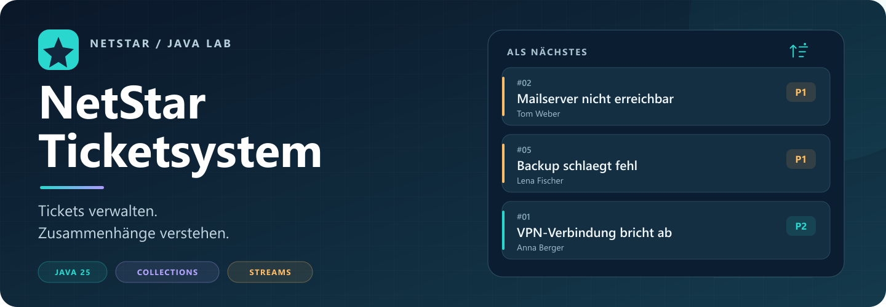
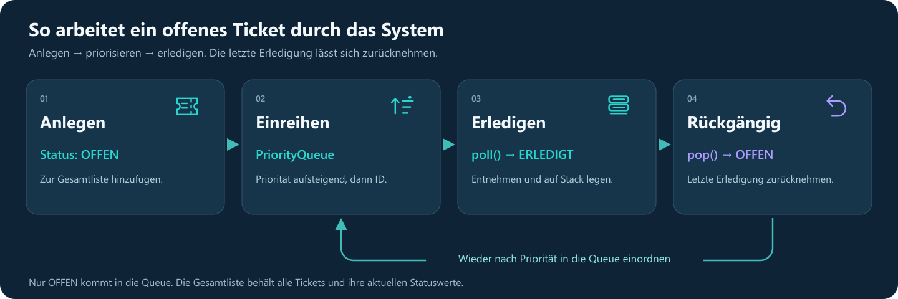

# NetStar Ticketsystem



[](https://github.com/trunkmak/NetStar-Ticketsystem/actions/workflows/java.yml) · [Roadmap](ROADMAP.md) · [Meilensteine](https://github.com/trunkmak/NetStar-Ticketsystem/milestones) · [Offene Aufgaben](https://github.com/trunkmak/NetStar-Ticketsystem/issues)

Java-Konsolenprojekt aus der Umschulung: Tickets verwalten und mit **Collections, Lambdas und Streams** auswerten. Das Repository verbindet den vorhandenen Programmstand mit einer nachvollziehbaren Lern- und Aufgabenübersicht.

**Stand: 15. Oktober 2026.** Basisfunktionen und Zusatzaufgaben Z1–Z4 sind vorhanden. Teil 2 ist als Roadmap mit Issues und Meilensteinen geplant. Die fünf importierten Java-Dateien entsprechen unverändert dem lokalen IntelliJ-Projekt.

## Schnellstart

Voraussetzung: **JDK 25**, einschließlich `java`, `javac` und `javadoc`. Keine externen Bibliotheken, kein Maven oder Gradle erforderlich. Die Projektprüfung wurde mit JDK 25.0.1 durchgeführt.

```sh
git clone https://github.com/trunkmak/NetStar-Ticketsystem.git
cd NetStar-Ticketsystem
javac -encoding UTF-8 -d build/classes src/*.java
java -cp build/classes Main
```

In PowerShell alternativ: `./scripts/start.ps1`. Das Skript verwendet `JAVA_HOME`, sofern gesetzt, sonst die Werkzeuge aus `PATH`. In IntelliJ den Repository-Ordner öffnen, JDK 25 auswählen, `src` als Sources Root markieren und `Main.main()` starten.

## Bedienung

| Menü | Funktion |
| --- | --- |
| 1 | Alle Tickets anzeigen |
| 2 | Ticket mit Titel, Kunde, Bearbeiter und Priorität 1–4 anlegen |
| 3 | Dringendstes offenes Ticket erledigen; bei gleicher Priorität kleinere ID zuerst |
| 4 | Letzte in dieser Sitzung ausgeführte Erledigung rückgängig machen |
| 5 | Alle Tickets nach Bearbeiter gruppiert anzeigen |
| 6 | Kunden ohne doppelte Namen anzeigen |
| 7 | Auswertungen: offene und kritische Tickets, Top 3, Bearbeiterzahlen, Durchschnitt, Kundenzahlen und Beispielkunde |
| 8 | Titel durchsuchen, unabhängig von Groß-/Kleinschreibung (Z3) |
| 9 | Erstes kritisches Ticket eines Bearbeiters in Listenreihenfolge finden (Z4) |
| 0 | Programm beenden |

Prioritäten: **1 kritisch**, 2 hoch, 3 normal, 4 niedrig. Statuswerte: `OFFEN`, `IN_BEARBEITUNG`, `ERLEDIGT`. Nur `OFFEN` zählt in den entsprechenden Filtern und der Warteschlange. Beim Neustart werden wieder zehn Beispieltickets geladen; es gibt keine dauerhafte Speicherung.

## Welche Collection wofür und warum?

| Collection | Aufgabe im Programm | Begründung |
| --- | --- | --- |
| `ArrayList<Ticket>` | Gesamter Ticketbestand | Bewahrt Einfügereihenfolge und eignet sich für vollständige Durchläufe und Streams. Ein Set würde stattdessen Eindeutigkeit modellieren. |
| `PriorityQueue<Ticket>` als `Queue<Ticket>` | Auswahl des nächsten offenen Tickets | Z1 verlangt Dringlichkeit statt reiner Ankunftsreihenfolge: Priorität, dann ID. Eine `LinkedList` als FIFO-Queue würde zuerst das zuerst eingefügte Ticket liefern. |
| `Stack<Ticket>` | Erledigungen rückgängig machen | LIFO: Die letzte Erledigung wird zuerst zurückgenommen. Entspricht dem vorhandenen Lernprojekt; `Deque` wäre eine spätere Alternative. |
| `HashMap<String, List<Ticket>>` | Tickets nach Bearbeiter ablegen | Direkter Zugriff über den Bearbeiternamen; die Liste je Schlüssel enthält mehrere Tickets. |
| `HashSet<String>` | Kunden sammeln | Verhindert doppelte Kundennamen, ohne eine Sortierung zu versprechen. |
| `Map<String, Long>` | Stream-Auswertungen nach Kunde/Bearbeiter | `groupingBy` bildet Gruppen, `counting` liefert deren Größe als `Long`. |

`HashMap` und `HashSet` garantieren keine Ausgabereihenfolge. Die PriorityQueue ist keine vollständig sortierte Liste; ihre Auswahlregel gilt beim Entnehmen mit `poll()`.


## Der Weg eines Tickets



Das [Architekturkapitel](doku/architektur.md) erklärt die beteiligten Klassen und gemeinsam verwendeten Ticketreferenzen.

## Beispielablauf

Aus einem echten Lauf mit unveränderten Beispieldaten, gekürzt auf die relevanten Zeilen:

```text
Auswahl: 7
=== AUSWERTUNGEN ===

Offene Tickets: 6

Kritische offene Titel:
[Mailserver nicht erreichbar, Backup schlaegt fehl]

Durchschnittliche Prioritaet: 2.3
```

Mit Menü 3 wird zuerst Ticket #2 erledigt. Danach zeigt Menü 7 fünf offene Tickets; Menü 4 stellt den Ausgangszustand mit sechs offenen Tickets wieder her. Die dringendsten drei offenen Tickets beim Start sind **#2, #5, #1**.

## Dokumentation und Lernen

- [Aufgabenstand und Zuordnung zum Code](doku/aufgabenstatus.md)
- [Roadmap mit Meilensteinen](ROADMAP.md)
- [Lernnotizen aus der Perplexity-Dokumentation](doku/lernnotizen.md)
- [Architektur und Klassendiagramm](doku/architektur.md)
- [Testprotokoll mit echten Ergebnissen](doku/testprotokoll.md)
- [Quellen, Dateinamen und Einschränkungen](doku/quellen/README.md)
- [Generierte API-Dokumentation](doku/api/index.html) – HTML lokal im Browser öffnen; GitHub zeigt die Datei als Quelltext. Einstieg lokal auch über `doku/index.html`.

API-Dokumentation neu erzeugen:

```sh
javadoc -encoding UTF-8 -docencoding UTF-8 -charset UTF-8 -d doku/api -sourcepath src src/TicketSystem.java src/Auswertung.java
```

PowerShell: `./scripts/javadoc.ps1`. Aktuell entsteht eine Warnung zum undokumentierten Standardkonstruktor von `TicketSystem`; D1 ist deshalb noch teilweise offen. Der vorhandene Undo-Kommentar beschreibt noch eine FIFO-Queue und muss an die PriorityQueue angepasst werden.

## Nächste Schritte

Die [Roadmap](ROADMAP.md) führt die offenen Aufgaben D1/D2, E1–E4 und T1/T2 mit überprüfbaren Abschlusskriterien auf. Die Menüpunkte 8/9 sind bereits durch Z3/Z4 belegt und müssen für Teil 2 bewusst neu zugeordnet werden.

**Quellenhinweis:** Die Aufgabenübersicht wurde gegen das vierseitige Original-Tagesprojekt und das vierseitige Bonusblatt abgeglichen. Bei A3/A4 gelten im aktuellen Stand wegen Z1 die Prioritätsreihenfolge und die daraus folgende Undo-Reihenfolge.

## Herkunft und Mitarbeit

Das Ausgangsmaterial nennt Christopher Partridge für `Ticket`, `Beispieldaten` und das Menügerüst sowie Hermann Zimmermann für die Bearbeitung. Diese Hinweise bleiben erhalten. Die PDFs liegen mit Quellenzuordnung bei; die Perplexity-Unterhaltung wird als Lernprotokoll verwendet und mit dem aktuellen Code abgeglichen. Die Repository-Dokumentation wurde mit KI-Unterstützung strukturiert.

Es wurde keine neue Lizenz vergeben. Eine öffentliche Ablage ist keine pauschale Freigabe der enthaltenen Fremdmaterialien. Hinweise für weitere Änderungen stehen in [CONTRIBUTING.md](CONTRIBUTING.md).
