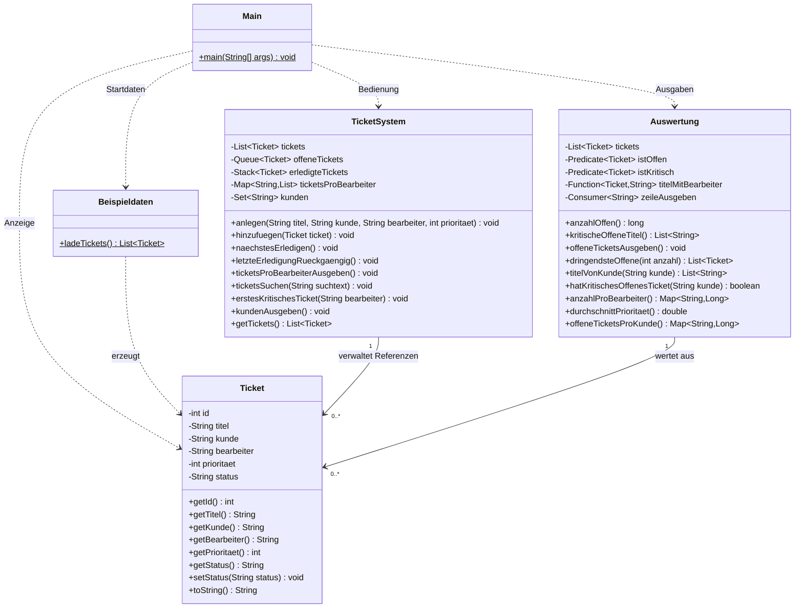

# Architektur und Datenfluss

Das Programm hat fünf Klassen im Standardpackage. `Main` liest Eingaben und ruft Fachmethoden auf. `TicketSystem` verwaltet den Bestand, `Auswertung` liest dieselbe Bestandsliste, `Beispieldaten` stellt zehn Starttickets bereit, `Ticket` trägt die Daten.

Das Diagramm ist eine lesbare Architekturübersicht. Für D2 fehlen noch das vollständige UML-Inventar einschließlich Konstruktoren, Statuskonstanten, ausgeschriebener verschachtelter Map-Typen sowie ein geprüfter Bild-/PDF-Export. D2 bleibt deshalb teilweise offen.

## Collections im Zusammenspiel

`hinzufuegen` aktualisiert Liste, Bearbeiter-Map und Kunden-Set. Nur bei Status `OFFEN` kommt die Referenz auch in die PriorityQueue. `naechstesErledigen` entnimmt die dringendste Referenz, ändert den Status und legt sie auf den Stack. Undo nimmt die letzte Referenz vom Stack, setzt sie auf `OFFEN` und ordnet sie erneut in die Queue ein.

Für den Bestand gelten die offenen IDs **1, 2, 3, 5, 7, 9**. Die Reihenfolge beim Erledigen lautet **2, 5, 1, 7, 9, 3**. Die bei Programmstart bereits erledigten Tickets #4/#8 befinden sich nicht im Undo-Stack; rückgängig gemacht werden nur Erledigungen aus der laufenden Sitzung.

`Auswertung` besitzt keinen eigenen Snapshot. Ihr Konstruktor speichert die übergebene Listenreferenz. Änderungen am Bestand werden deshalb im nächsten neu erzeugten Stream berücksichtigt. Die zurückgegebene Liste ist öffentlich veränderbar; eine spätere Kapselungsverbesserung muss diesen Datenfluss bewusst erhalten.
