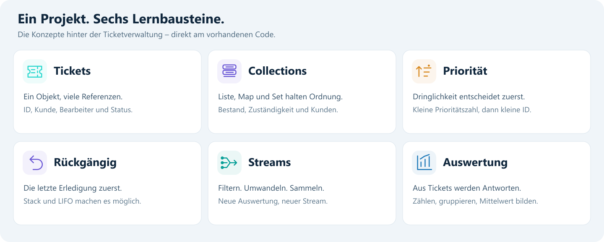

# Mein Vorgehen und was ich gelernt habe

*Rückblick von Hermann Zimmermann auf den Stand vom 15.10.2026. Der Text wurde aus meinem vorhandenen Quellcode und dem dokumentierten Lernverlauf zusammengefasst. Die fachlichen Arbeitsschritte sind thematisch geordnet; eine lückenlose zeitliche Reihenfolge ist damit nicht behauptet. Die spätere Repository-Aufbereitung ist gesondert beschrieben.*

## Mein Ausgangspunkt

Die Aufgabe war, eine Java-Konsolenanwendung für die Ticketverwaltung einer IT-Firma zu entwickeln. Die Klasse `Ticket`, zehn Beispieltickets und das Menügerüst waren bereits vorgegeben. Meine Bearbeitung bestand vor allem darin, die Verwaltung in `TicketSystem`, die Stream-Auswertungen in `Auswertung` und die passenden Menüaufrufe zu ergänzen.

An diesem Projekt konnte ich Datenstrukturen mit einem konkreten Anwendungsfall verbinden: Tickets müssen gespeichert, nach Dringlichkeit bearbeitet, wieder geöffnet und nach verschiedenen Kriterien ausgewertet werden. Dafür reicht eine einzelne Liste als Denkmodell nicht aus.

## Wie ich die Aufgaben bearbeitet habe

### Den Bestand verwalten und Zuständigkeiten trennen

In `TicketSystem` habe ich die fünf Collections für Bestand, offene Tickets, Erledigungen, Bearbeiterzuordnung und Kunden verwendet. Beim Anlegen wird die größte vorhandene ID ermittelt und um eins erhöht. Ein neues Ticket beginnt mit dem Status `OFFEN` und wird über `hinzufuegen` in die zugehörigen Strukturen aufgenommen.

Die Eingaben werden in `Main` verarbeitet. Die eigentliche Verwaltung liegt in `TicketSystem`. Diese Trennung hilft mir, zwischen der Bedienung des Programms und seiner fachlichen Arbeit zu unterscheiden.

**Was ich dabei gelernt habe:** Eine Collection wird wegen ihrer Aufgabe ausgewählt. Die Map beantwortet eine andere Frage als die Queue, und der Stack hat einen anderen Zweck als die Gesamtliste. Außerdem können mehrere Collections auf dasselbe Ticketobjekt zeigen. Eine Statusänderung ist deshalb auch über die anderen Referenzen sichtbar.

### Dringlichkeit und Rückgängig zusammenbringen

Für die Zusatzaufgabe Z1 habe ich die Bearbeitung auf eine PriorityQueue umgestellt. Der Comparator berücksichtigt zuerst die Priorität und bei Gleichstand die ID. Eine kleinere Prioritätszahl bedeutet eine höhere Dringlichkeit.

Die Rückgängig-Funktion verwendet weiterhin einen Stack. Sie nimmt die zuletzt ausgeführte Erledigung zurück, setzt das Ticket auf `OFFEN` und fügt es wieder in die PriorityQueue ein. Es erhält dort seinen Platz nach den Sortierregeln.

**Was ich dabei gelernt habe:** FIFO, LIFO und die Auswahl nach Priorität sind verschiedene Regeln. Nach Z1 passen die ursprünglichen FIFO-Prüfwerte aus dem Aufgabenblatt nicht mehr zum aktuellen Verhalten. Auch ein Kommentar wie „hinten anhängen“ muss dann überprüft werden.

### Auswertungen in einzelne Stream-Schritte zerlegen

In `Auswertung` habe ich Regeln für offene und kritische Tickets als Predicates verwendet. Dazu kommen eine Function für Titel mit Bearbeiter und ein Consumer für die Ausgabe. Die Methoden zählen, filtern, sortieren, gruppieren oder berechnen den Durchschnitt.

Beim Durcharbeiten habe ich die Stream-Ketten in kleine Fragen zerlegt: Welche Tickets werden ausgewählt? Welcher Wert soll aus einem Ticket entstehen? Was soll am Ende zurückgegeben oder ausgegeben werden?

**Was ich dabei gelernt habe:** `filter` prüft eine Bedingung, `map` verändert die betrachtete Werteart und eine terminale Operation erzeugt das Ergebnis. `anyMatch` passt zur Frage, ob mindestens ein Treffer existiert. Für die dringendsten drei Tickets muss die Sortierung vor der Begrenzung stehen.

Die Unterscheidung zwischen `istOffen` und `istOffen.test(ticket)` war ebenfalls ein Lernpunkt: Das eine ist die gespeicherte Regel, das andere wendet sie auf ein konkretes Ticket an.

### Gruppierung und Rückgabetypen verstehen

Beim Zählen pro Bearbeiter und pro Kunde habe ich `groupingBy` zusammen mit `counting` verwendet. Dabei musste ich mir klarmachen, was der Schlüssel und was der Wert der Map ist.

**Was ich dabei gelernt habe:** `Map<String, List<Ticket>>` enthält Gruppen von Tickets, `Map<String, Long>` dagegen Gruppengrößen. `counting` liefert eine Anzahl als `Long`. Für offene Tickets pro Kunde muss zuerst der Status gefiltert werden.

Auch beim Durchschnitt gibt es einen Unterschied zwischen einer Zahl und einem möglicherweise fehlenden Ergebnis. `average()` liefert einen optionalen Wert; mit `orElse(0.0)` legt meine Methode fest, was bei einer leeren Liste zurückgegeben wird.

### Suche und Optional im Menü verwenden

Die Titelsuche habe ich so aufgebaut, dass Suchbegriff und Titel kleingeschrieben verglichen werden. Die Variable `suche` enthält den vorbereiteten Suchbegriff und wird in `contains` verwendet.

Für das erste kritische Ticket eines Bearbeiters habe ich nach Bearbeiter und Priorität gefiltert und `findFirst()` eingesetzt. Weil es keinen Treffer geben kann, wird das Optional vor dem Zugriff geprüft. Die Eingabe erfolgt im Menü; die Suchlogik bleibt in `TicketSystem`.

**Was ich dabei gelernt habe:** Ein fehlender Treffer ist ein erwartbarer Fall. Außerdem bedeutet „erstes kritisches Ticket“ hier die Reihenfolge der Liste und enthält nicht automatisch die zusätzliche Bedingung „offen“.

Beim Ergänzen des Menüfalls trat eine Namenskollision mit `bearbeiter` auf. Der Name `gesuchterBearbeiter` machte den Zweck deutlicher und vermied die doppelte lokale Variable im gemeinsamen `switch`-Bereich.

### Die Methoden durch Javadoc erneut durchgehen

Bei der Javadoc-Aufgabe habe ich die Methoden noch einmal bewusst gelesen und beschrieben. Für jede musste ich mir überlegen, welche Parameter sie erhält, was sie mit den Daten macht und welches Ergebnis sie liefert.

Im Aufgabenblatt waren etwa 40 Minuten vorgesehen. Ich habe dafür fast einen halben Schultag gebraucht. Viel Zeit ging dafür auf, mir die jeweilige Methode erneut ins Gedächtnis zu rufen, sie zu verstehen und das anschließend verständlich zu formulieren.

**Was ich dabei gelernt habe:** Dokumentieren zeigt, ob ich eine Methode wirklich erklären kann. Es geht dabei auch um Rückgabetypen und fachliche Bedeutung. Ein hilfreiches Muster ist für mich: **Eingabe – Verarbeitung – Ergebnis**. Danach lassen sich Kurzbeschreibung, `@param` und `@return` leichter formulieren.

Ein konkreter Fund war, dass `offeneTicketsProKunde()` zwar vorhanden war, aber noch nicht im Menü benutzt wurde. Das habe ich beim Durchgehen bemerkt; im aktuellen Stand ist die Ausgabe in Menü 7 eingebunden. Eine vorhandene Methode und eine tatsächlich nutzbare Menüfunktion sind zwei verschiedene Arbeitsschritte.

## Wie ich mit Erklärungen und Problemen umgegangen bin

Ich habe einzelne Begriffe und Codezeilen gezielt geklärt, eigene Ansätze formuliert und sie schrittweise überprüft. Dabei ging es unter anderem um `Optional`, `test`, `pop`, Map-Werte und Javadoc-Tags. Bei Verwechslungen habe ich die Bedeutung noch einmal auf ein konkretes Ticket oder Beispiel angewendet. Die daraus gewonnenen Erklärungen stehen in den [Lernnotizen](lernnotizen.md).

Beim Erzeugen der Javadoc kamen zusätzlich Werkzeugprobleme dazu: `Input length = 1`, nicht gefundenes `javadoc`, verschiedene Arbeitsverzeichnisse und Quellpfade. Dabei kamen mehrere mögliche Ursachen infrage, die nicht alle als tatsächliche Ursache bestätigt wurden.

**Was ich daraus mitnehme:** Eine Fehlermeldung zuerst genau lesen und dann Werkzeug, Pfade und Daten getrennt prüfen. Eine mögliche Erklärung muss ich mit einem konkreten Test überprüfen. Bei der späteren Repository-Prüfung ließ sich Javadoc im vorhandenen Pfad erzeugen; die verbleibende Warnung betrifft den Standardkonstruktor von `TicketSystem`.

## Meine wichtigsten Lernerfahrungen

| Thema | Was ich mir aus dem Projekt mitnehme | Konkretes Beispiel |
| --- | --- | --- |
| Datenstrukturen | Die benötigte Operation bestimmt die Collection. | PriorityQueue für Dringlichkeit, Stack für Undo |
| Referenzen | Verschiedene Zugriffe können dieselben veränderbaren Daten sehen. | TicketSystem und Auswertung verwenden dieselbe Liste. |
| Lambdas | Eine gespeicherte Regel und ihr konkretes Prüfergebnis unterscheiden. | `istOffen` und `istOffen.test(ticket)` |
| Streams | Eine Kette in Auswahl, Umwandlung und Ergebnis zerlegen. | `filter`, `map`, `collect` |
| Fachliche Bedingungen | Ähnliche Begriffe nicht gleichsetzen. | Kritisch ist nicht automatisch offen. |
| Rückgabetypen | Der Typ zeigt, welche Art von Antwort eine Methode liefert. | Ticketliste, Anzahl, boolean oder Optional |
| Dokumentation | Eine Methode verständlich beschreiben zu können ist eine eigene Übung. | Javadoc anhand von Eingabe, Verarbeitung und Ergebnis |
| Fehlerbehandlung | Auch leere Ergebnisse und ungültige Eingaben einplanen. | Leere Queue, leerer Stack, unbekannter Bearbeiter |

Diese Punkte beschreiben den bearbeiteten Lernstoff. Durch die nächsten Aufgaben will ich das Verständnis weiter festigen und mit eigenen wiederholbaren Tests absichern.

## Was bei der Repository-Aufbereitung ergänzt wurde

Nach meinem vorhandenen Programmstand wurde das GitHub-Repository mit KI-Unterstützung strukturiert. Dabei kamen README, Lernunterlagen, Aufgabenstatus, Roadmap, Meilensteine, Issues und eigene Projektgrafiken hinzu. Die fünf Java-Dateien wurden dafür unverändert übernommen.

Bei dieser Aufbereitung wurden **27 Prüfungen** tatsächlich ausgeführt und im [Testprotokoll](testprotokoll.md) festgehalten. Die automatische GitHub-Prüfung kompiliert das Projekt, prüft die Startauswertung und erzeugt Javadoc. Diese nachträglichen Prüfungen sind von meiner noch offenen Aufgabe T1, einer eigenen `Selbsttest.java`, zu unterscheiden.

## Was ich beim nächsten Mal bewusster machen möchte

1. Vor dem Schreiben die Aufgabe in kleine prüfbare Schritte zerlegen.
2. Pro Methode Eingabe, Verarbeitung und Ergebnis kurz notieren.
3. Eine kleine Änderung kompilieren und sofort mit einem passenden Fall ausprobieren.
4. Zu jedem Trefferfall auch einen Fall ohne Ergebnis oder mit ungültiger Eingabe prüfen.
5. Nach einer Erweiterung Kommentare, Menübeschreibung und Erwartungswerte mitprüfen.
6. Den Lernaufwand beim Zeitplan berücksichtigen: Neue Begriffe verstehen und später wiederholen braucht zusätzliche Zeit.

Als Nächstes stehen der Abschluss von D1 und die eigene Selbsttest-Klasse im Vordergrund. Danach folgen die auswählbaren Erweiterungen aus Teil 2. Für T2 muss zunächst die fehlende Originaldatei `Fehlersuche.java` vorliegen. Die [Roadmap](../ROADMAP.md) hält diese nächsten Schritte fest.

## Grundlage dieses Rückblicks

- [Tagesprojekt](quellen/tagesprojekt.pdf), insbesondere Teil A/B und Z1–Z4.
- [Bonusaufgaben](quellen/teil-2-bonusaufgaben.pdf), insbesondere D1 und die nächsten Lernaufgaben.
- Aktueller Quellcode in [TicketSystem](../src/TicketSystem.java), [Auswertung](../src/Auswertung.java) und [Main](../src/Main.java).

Weiterlesen: [Alle Aufgaben](aufgaben.md) · [Tipps und Tricks](tipps-und-tricks.md) · [Lernnotizen zu einzelnen Konzepten](lernnotizen.md).
